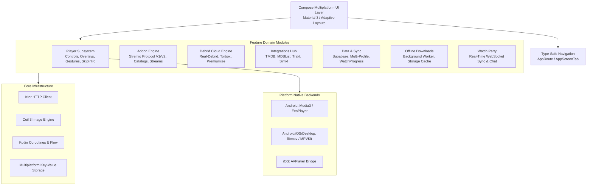

# Project Architecture & Technical Reference: Nuvio

## 1. System Overview

**Nuvio** is an extensible, cross-platform media streaming application built with **Kotlin Multiplatform (KMP)** and **Compose Multiplatform (CMP)**. It targets Android phones, tablets, foldables, Android TV, iOS devices, and Desktop environments from a unified shared codebase.

The system adheres to a **Bring Your Own Sources (BYOS)** architecture, decoupling media playback and UI presentation from media hosting. Users provide their own sources via standard Stremio Addon manifests, Debrid cloud providers, or peer-to-peer torrent backends.

---

## 2. Core Architecture & Technology Stack



### Technology Matrix
- **Language**: Kotlin 2.1+ Multiplatform
- **UI Toolkit**: Compose Multiplatform with Material 3 (Monet dynamic theming)
- **Asynchronous Engine**: Kotlin Coroutines, StateFlow, SharedFlow
- **Networking**: Ktor Client with content negotiation and SSE/WebSocket support
- **Image Loading**: Coil 3 (with custom SVG decoders and cache fallback interceptors)
- **Video Decoding**:
  - Android: `androidx.media3:media3-exoplayer` (HLS, DASH, MP4, MKV hardware decoders)
  - Cross-platform / Subtitles: `MPVKit` / `libmpv` (Advanced SubStation Alpha `.ass`/`.ssa` styling)
  - iOS: Native `AVPlayer` and `MPVKit` bridge
- **Backend & Synchronization**: Supabase (Auth, PostgreSQL real-time sync, Storage)

---

## 3. Subsystem Deep Dives

### 3.1. Video Player Subsystem
The player subsystem provides a unified API (`PlayerEngine`) abstracting underlying platform decoders while maintaining uniform controls, gestures, and overlay behaviors.

- **Dual-Engine Abstraction**:
  - `PlayerEngine.android.kt`: ExoPlayer implementation prioritizing battery efficiency, wide codec support, and smooth platform integration.
  - `PlayerEngine.ios.kt`: AVPlayer / MPVKit bridge enabling high-performance video rendering and ASS subtitle styling on iOS.
- **Player Gestures**:
  - Horizontal drag: High-precision scrubbing with time preview.
  - Vertical drag (left): Smooth screen brightness control.
  - Vertical drag (right): Audio volume scaling.
  - Double-tap: 10-second fast forward / rewind.
- **Foldable & Dual-Screen Layout (`FoldControls.kt`)**:
  - Automatically identifies hinge boundaries on dual-screen and foldable devices.
  - Places the active video surface on the upper display while moving episodes lists, audio tracks, and controls to the lower display.

### 3.2. Player Controls & Ergonomics Redesign
- **Bottom Bar Rebalancing**:
  - Completely eliminated the redundant "1x" speedometer button from the main control bar to reduce visual clutter.
  - Adjusted button spacing to an ergonomic `6.dp` layout (`PlayerControlActions.kt`).
  - Added dedicated access to audio track selection, subtitle options, chapters list, and stream sources.

### 3.3. Buffering & Network State Resilience
- **Central Loading Spinner**:
  - Dynamically evaluates buffering state:
    ```kotlin
    val isBuffering = (playbackSnapshot.isLoading || (networkStatus.isOfflineLike && !isLocalSource)) && errorMessage == null
    ```
  - When `isBuffering` is true, a circular `NuvioLoadingIndicator` replaces the central Play/Pause button.
  - Play/Pause interaction is safely disabled during buffering to prevent race conditions and playback state desynchronization.
- **Overlay Persistence on Control Hide**:
  - When player controls auto-hide after inactivity while buffering continues, the central spinner persists smoothly via `PlayerPlaybackOverlays.kt` at `metrics.centerLift`.

### 3.4. Skip Intro Resolution Pipeline
- **Decoupled Fast-Path Resolution**:
  - Decoupled `IntroDb` interval lookup from external `SimklIdResolver` blocking calls, allowing intro intervals to resolve instantaneously.
  - Increased network timeout to `8_000L` ms to accommodate slower upstream metadata connections.
- **Persistent Visibility & Action**:
  - Retained `SkipIntroButton` visibility throughout the intro interval until the user interacts or the segment finishes.
  - Clicking "Skip Intro" triggers an accurate seek operation to the exact segment end timestamp:
    ```kotlin
    onSeekTo(interval.endMs)
    ```

### 3.5. Stremio Addon Protocol Engine
- **Protocol Compliance**:
  - Full support for Stremio Addon Protocol versions 1 and 2.
  - Manifest parser validating `id`, `name`, `version`, `resources` (catalog, stream, meta, subtitles), and `types` (movie, series, anime, tv).
- **Transport & Security**:
  - Supports HTTP/HTTPS URLs, IPFS links, and Base64-encoded configurations.
  - Addon repository handles parallel catalog aggregation, category filtering, and type-safe error handling.

### 3.6. Debrid Cloud Acceleration Layer
- **Supported Providers**: Real-Debrid, Torbox, Premiumize.
- **Resolver Logic (`DirectDebridResolver.kt`)**:
  - Intercepts stream magnet links or info-hashes from add-ons.
  - Queries Debrid availability caches to find instantly available cloud streams.
  - Unrestricts files into direct CDN HTTP URLs, bypassing P2P network bottlenecks.
- **P2P Fallback**:
  - Embedded `TorrServer` client for non-Debrid torrent streams with live peer monitoring and memory buffering.

### 3.7. Cloud Synchronization & Multi-Profile
- **Supabase Integration**:
  - Multi-profile management per account.
  - Real-time synchronization of watch progress, bookmarks, custom collections, and active add-on installations.
- **Trakt.tv & Simkl 2-Way Sync**:
  - Automatic scrobbling at 80% completion threshold.
  - Watch progress reconciliation between local storage and remote tracking APIs.

---

## 4. Key Interface Contracts

### PlayerControlActions ↔ PlayerControlsShell
- Spacing: `Arrangement.spacedBy(6.dp)`
- Actions: Audio track modal, Subtitle selector, Chapters sheet, Source selector, Video settings modal.
- Removed: `onSpeedClick` button from bottom row.

### PlayerControls ↔ PlayerPlaybackOverlays
- Buffering state passed through to overlays:
  ```kotlin
  isBuffering = (snapshot.isLoading || networkStatus.isOfflineLike) && errorMessage == null
  ```
- Center play/pause slot renders `NuvioLoadingIndicator` when `isBuffering == true`.
- Central loading indicator displayed in `PlayerPlaybackOverlays` when controls are hidden and video is buffering.

### SkipIntroButton ↔ SkipIntroRepository
- Decoupled TV intervals from `SimklIdResolver` blocking dependencies.
- Segment duration evaluation:
  ```kotlin
  val isIntroActive = currentPositionMs in interval.startMs..interval.endMs
  ```

---

## 5. Source Directory Layout

```
composeApp/src/commonMain/kotlin/com/nuvio/app/
├── core/
│   ├── auth/                      # Authentication & session management
│   ├── build/                     # Runtime feature flags and configurations
│   ├── i18n/                      # Internationalization & localized strings
│   ├── network/                   # Network monitoring & HTTP client setup
│   ├── poster/                    # Poster caching & custom fallback interceptors
│   └── ui/                        # Material 3 themes, typography, elevation
├── features/
│   ├── addons/                    # Stremio Addon protocol implementation
│   ├── auth/                      # Login, signup, device-link authorization
│   ├── catalog/                   # Browse feeds, genre filters, carousels
│   ├── debrid/                    # Real-Debrid, Premiumize, Torbox integrations
│   ├── details/                   # Media synopsis, cast, seasons, recommendations
│   ├── downloads/                 # Offline video downloader & cache management
│   ├── home/                      # Home dashboard, trending feeds, continue watching
│   ├── library/                   # User bookmarks, history, custom lists
│   ├── mdblist/                   # MDBList rating cards & user lists
│   ├── party/                     # Watch party rooms, WebSocket sync, live chat
│   ├── player/                    # Complete video player subsystem
│   │   ├── skip/                  # Skip intro engine (AniSkip, IntroDb)
│   │   ├── PlayerControlActions.kt
│   │   ├── PlayerControls.kt
│   │   ├── PlayerPlaybackOverlays.kt
│   │   ├── PlayerGestureOverlay.kt
│   │   └── FoldControls.kt
│   ├── settings/                  # App preferences, theme customization, integrations
│   ├── simkl/                     # Simkl scrobbling & anime metadata
│   ├── trakt/                     # Trakt scrobbling & history synchronization
│   └── watching/                  # Continue watching progress trackers
└── navigation/                    # Route destinations & navigation graphs
```

---

## 6. Build & Verification Guidelines

- **Clean Build**:
  ```bash
  ./gradlew clean
  ```
- **Android Assembly**:
  ```bash
  ./gradlew :androidApp:assembleFullDebug
  ```
- **Unit & Logic Tests**:
  ```bash
  ./gradlew :composeApp:testDebugUnitTest
  ```
- **iOS Simulator Build**:
  ```bash
  env NUVIO_IOS_DISTRIBUTION=full xcodebuild \
    -project iosApp/iosApp.xcodeproj \
    -scheme iosApp \
    -configuration Debug \
    -sdk iphonesimulator \
    -derivedDataPath build/ios-derived-full-simulator \
    CODE_SIGNING_ALLOWED=NO \
    build
  ```
